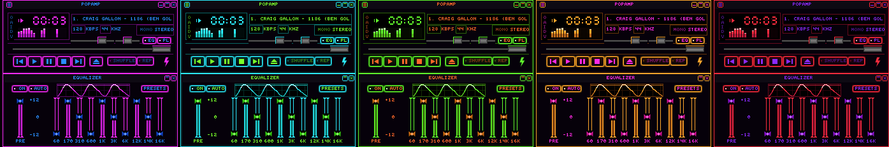

# Purple Glow

# ⚠️ This skin was generated automatically

## It needs a designer's edits

The pictures were written by a program, not drawn by a designer. Fork it
and redraw it.

After the Winamp 2 skin "Purple Glow v2", whose archive could not be
found. Nothing of the original is copied: the look was redrawn from a
single screenshot with whole simple shapes. The buttons are rounded and
glow (an outline blurred by an SVG filter behind each one); the title
strips are one flat near-black fill, edged in the same glow as the rest of
the window whether it is focused or not; only the name dims. The look it
started from lives on as
[Neon](https://github.com/popamp/skin-neon).

It draws every classic sheet in SVG, has a bar view of the main window
(the main menu's Toolbar mode), a media library window with its own
title, volume and balance sliders in the shaded equalizer, and five
colour sets for the glow (Purple, Cyan, Lime, Amber and Crimson) in the
main menu's Colours.

The SVG files and `skin.toml` are written by `tools/gen.py`
(`python3 -I -B tools/gen.py`). Every window is put together from the
same parts in `tools/parts.py`; the colours by role are in `tools/kit.py`.
The pictures lie by window: `main/`, `eq/` (equalizer), `pl/` (playlist),
`bar/` and `ml/` (media library); which sheet goes where is in
`tools/kit.py`. `fonts/text.svg` and `fonts/numbers.svg`, the lettering,
are drawn by hand and the script reads its letters from `fonts/text.svg`. The generator started as a copy
of [Popamp Default](https://github.com/popamp/popamp-skin-default)'s.



A vector skin for [Popamp](https://github.com/popamp/popamp), skin format
version 1. Needs Popamp 1.0.0 or newer.

## Install

With Popamp 1.0.0 or newer from [apt.popamp.app](https://apt.popamp.app):

```sh
sudo apt install popamp-skin-purple-glow
```

Then pick it in the main menu's skin list. Or clone it into Popamp's
skins folder, where a copy of the same name wins over the package:

```sh
git clone https://github.com/popamp/skin-purple-glow ~/.local/share/popamp/skins/purple-glow
```

## License

Licensed under either of [Apache License 2.0](LICENSE-APACHE) or
[MIT license](LICENSE-MIT) at your option.
